# JACON LTspice results (auto-generated by run_tests.py)

## AC_filter_responses
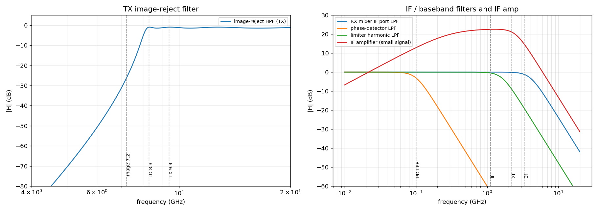

## JACON_schematic_overview
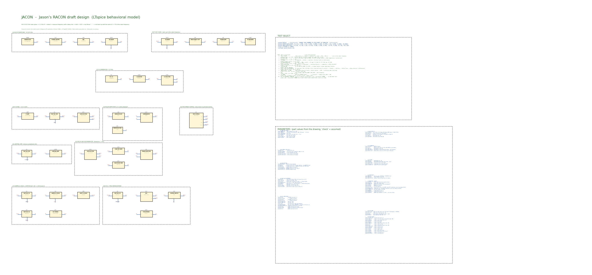

## T00_full_system_rx_zoom
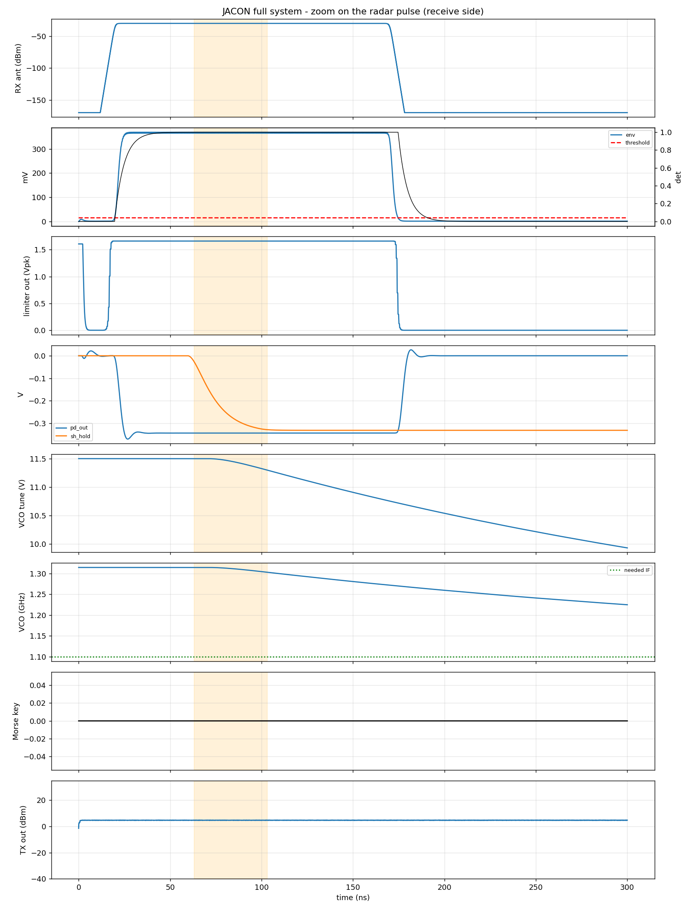

## T00_full_system_timeline
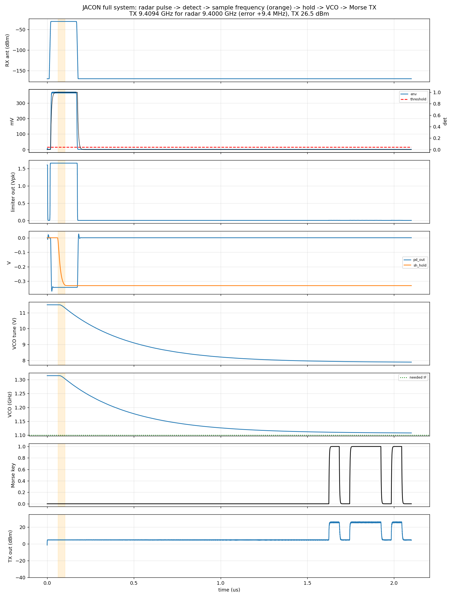

## T00_full_system_tx
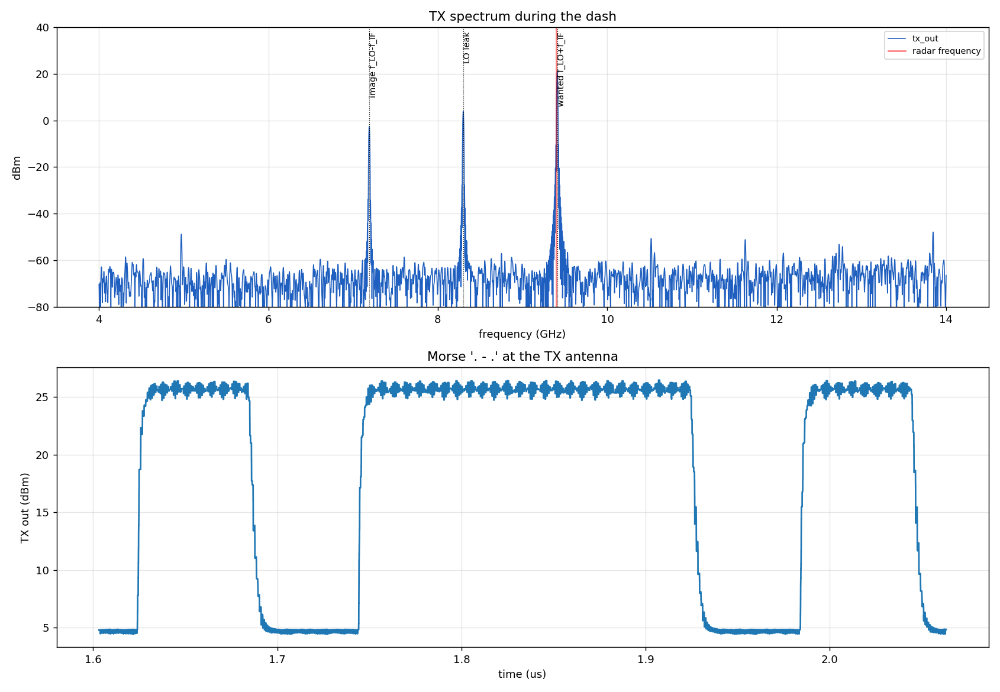

## T01_rx_front_end
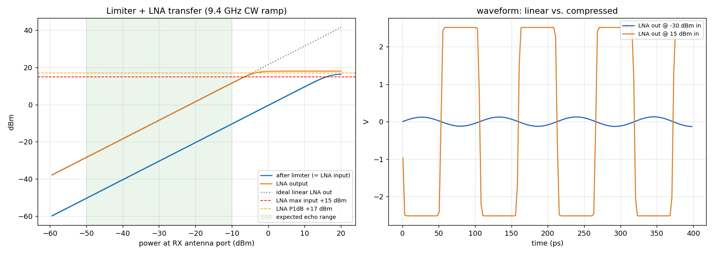

## T02_lo_chain
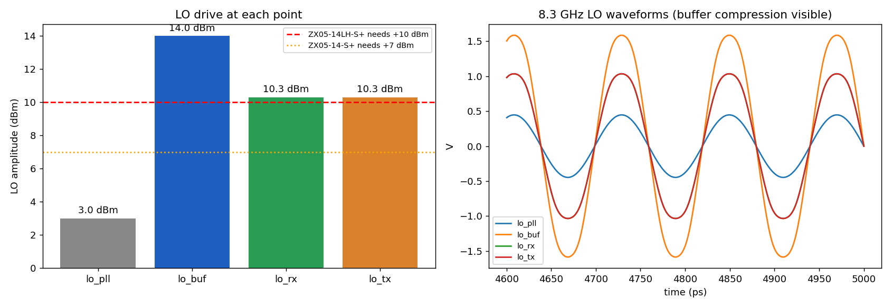

## T03_rx_downconversion
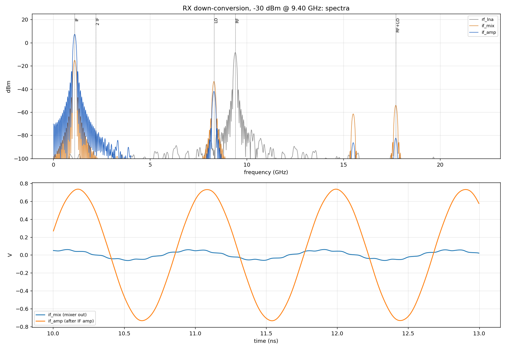

## T04_pulse_detection
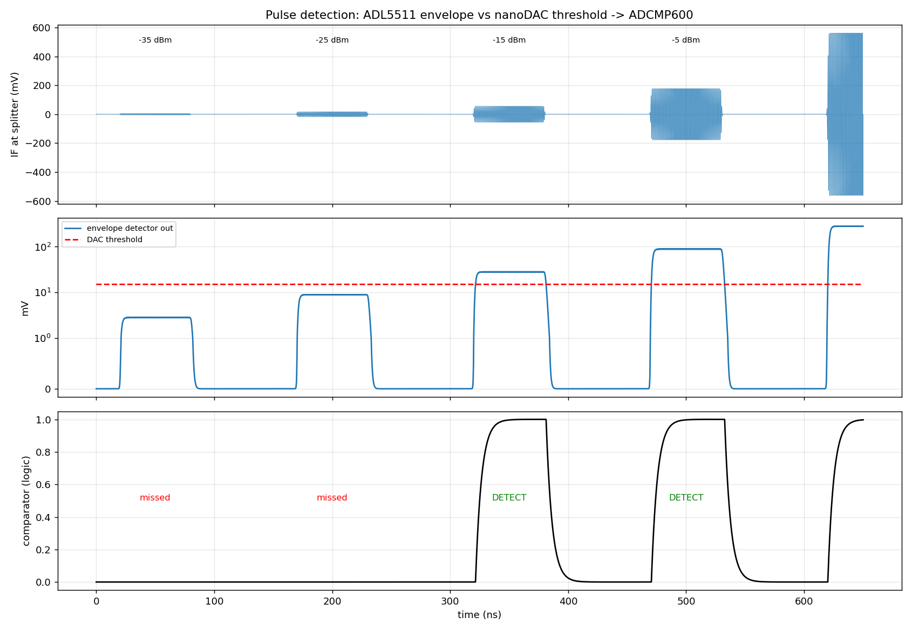

## T05_limiting_amp
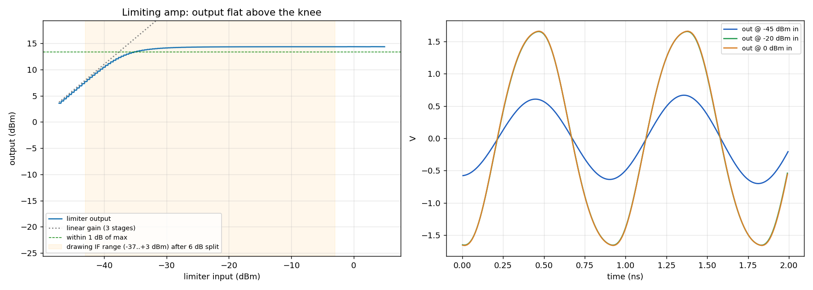

## T06_discriminator
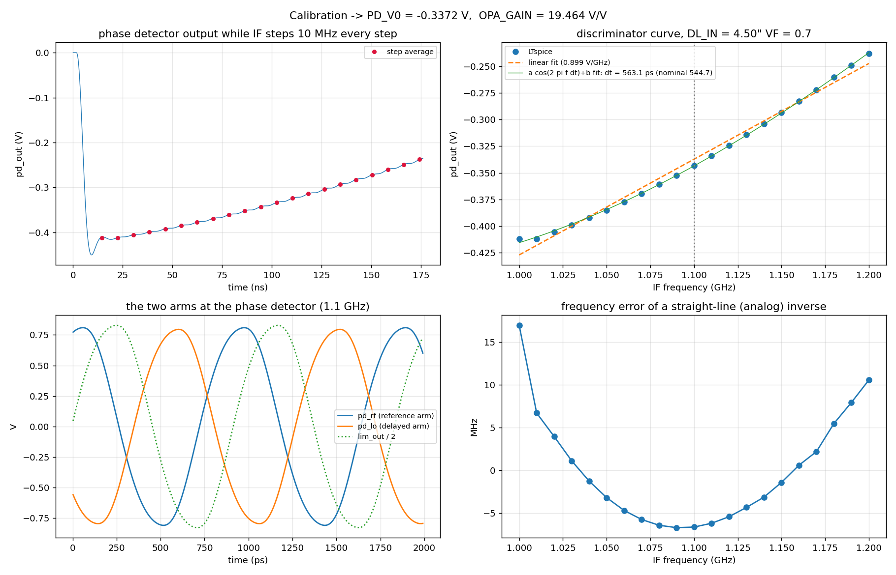

## T06_discriminator_dl270
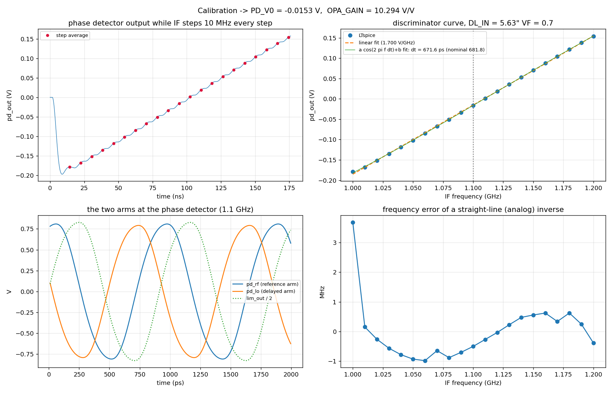

## T06_discriminator_dl90
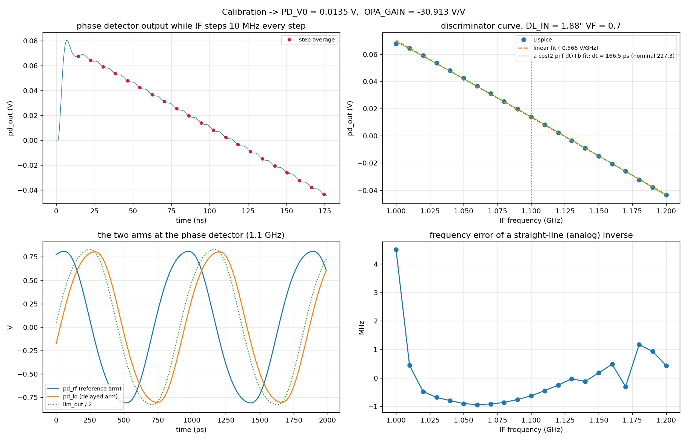

## T07_sample_hold_opamp
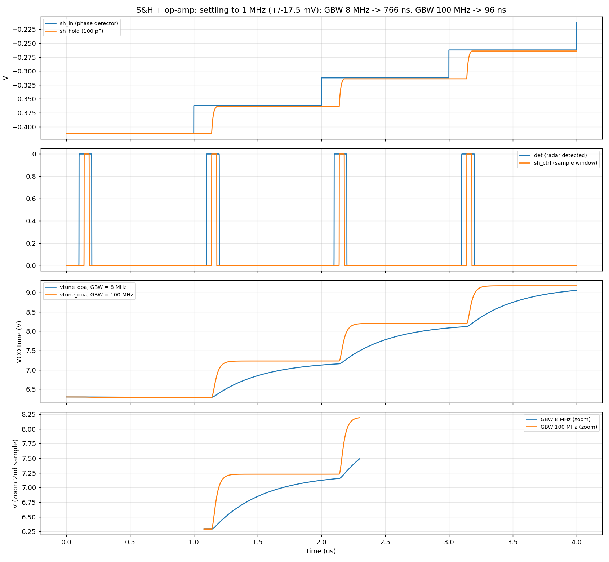

## T08_vco
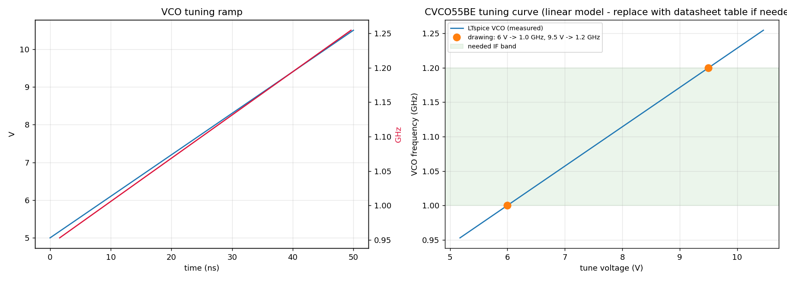

## T09_tx_chain
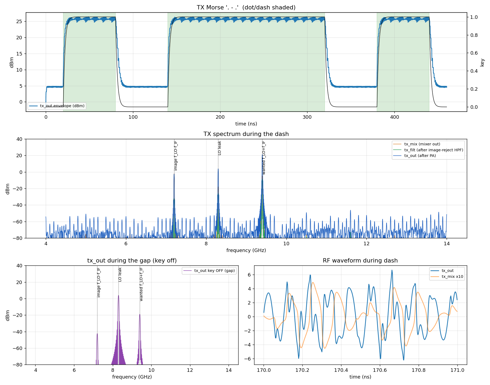

## T10_rx_to_tx_frequency_transfer
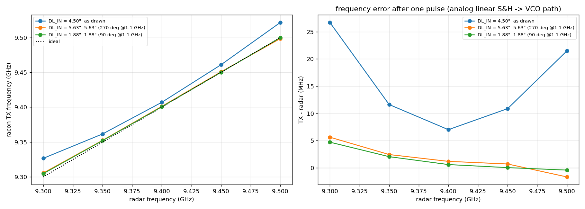

## Numbers
```json
{
  "AC": {
    "image-reject HPF (TX)": {
      "0.1 GHz": -299.9994834105614,
      "1.1 GHz": -196.7115151279196,
      "2.2 GHz": -141.43367071311775,
      "3.3 GHz": -107.80700826278994,
      "7.2 GHz": -26.59473741060599,
      "8.3 GHz": -1.0304218083372145,
      "9.4 GHz": -1.0078173502384697,
      "17.7 GHz": -1.4354699122986727
    },
    "RX mixer IF port LPF": {
      "0.1 GHz": -1.0602809425223126e-09,
      "1.1 GHz": -0.0018781908962980803,
      "2.2 GHz": -0.11858342476668265,
      "3.3 GHz": -1.1903364691291336,
      "7.2 GHz": -15.442175290327581,
      "8.3 GHz": -19.075065792034685,
      "9.4 GHz": -22.28970324283457,
      "17.7 GHz": -38.75530880791012
    },
    "phase-detector LPF": {
      "0.1 GHz": -3.010299956639802,
      "1.1 GHz": -62.4834570224656,
      "2.2 GHz": -80.54534793631392,
      "3.3 GHz": -91.11073233027967,
      "7.2 GHz": -111.43992277154462,
      "8.3 GHz": -115.14458501451817,
      "9.4 GHz": -118.38759005149393,
      "17.7 GHz": -134.8783297149289
    },
    "limiter harmonic LPF": {
      "0.1 GHz": -2.588596677882822e-07,
      "1.1 GHz": -0.4359988401949361,
      "2.2 GHz": -8.897477873777605,
      "3.3 GHz": -18.919597645004096,
      "7.2 GHz": -39.19324681598322,
      "8.3 GHz": -42.89760895242248,
      "9.4 GHz": -46.14049672958975,
      "17.7 GHz": -62.63113317352107
    },
    "IF amplifier (small signal)": {
      "0.1 GHz": 12.842979785992847,
      "1.1 GHz": 22.499989162361853,
      "2.2 GHz": 21.106341986694858,
      "3.3 GHz": 14.820833719281854,
      "7.2 GHz": -4.735680251299596,
      "8.3 GHz": -8.434117261558404,
      "9.4 GHz": -11.674167986471218,
      "17.7 GHz": -28.160231377836823
    }
  },
  "T2_lo_chain": {
    "levels_dBm": {
      "lo_pll": 2.9999987144363596,
      "lo_buf": 13.997788425372335,
      "lo_rx": 10.287488551926746,
      "lo_tx": 10.287488551926746
    },
    "mixer_LO_required_dBm": 10.0,
    "LO_margin_at_rx_mixer_dB": 0.28748855192674583
  },
  "T1_rx_front_end": {
    "max_power_into_LNA_dBm": 16.32226009018624,
    "extra_attenuation_needed_for_15dBm_dB": 1.3222600901862407,
    "LNA_out_at_-50dBm_in": -28.46768104418132,
    "LNA_out_at_-10dBm_in": 11.515907165141641
  },
  "T3_rx_downconversion": {
    "tone_levels_dBm": {
      "rf_lna": {
        "IF": -110.30086689859979,
        "LO": -91.80211076670994,
        "RF": -8.517851120835662,
        "RF+LO": -112.36635791662137,
        "2 IF": -110.39635716715162
      },
      "if_mix": {
        "IF": -15.156201763844718,
        "LO": -33.47122612903608,
        "RF": -116.22271930589295,
        "RF+LO": -54.08001782344658,
        "2 IF": -97.4004908579657
      },
      "if_amp": {
        "IF": 7.312281721051055,
        "LO": -41.94479363196203,
        "RF": -124.72533583823983,
        "RF+LO": -82.38956607752954,
        "2 IF": -75.78547571718755
      }
    },
    "mixer_conversion_gain_dB": -6.638350643009057
  },
  "T4_pulse_detection": {
    "threshold_V": 0.015,
    "pulses": [
      {
        "power_at_IF_splitter_dBm": -35.0,
        "power_at_env_det_dBm": -41.019999999999996,
        "detected": false,
        "latency_ns": null
      },
      {
        "power_at_IF_splitter_dBm": -25.0,
        "power_at_env_det_dBm": -31.02,
        "detected": false,
        "latency_ns": null
      },
      {
        "power_at_IF_splitter_dBm": -15.0,
        "power_at_env_det_dBm": -21.02,
        "detected": true,
        "latency_ns": 4.958940905026149
      },
      {
        "power_at_IF_splitter_dBm": -5.0,
        "power_at_env_det_dBm": -11.02,
        "detected": true,
        "latency_ns": 3.9997579920173547
      }
    ]
  },
  "T5_limiting_amp": {
    "max_output_dBm": 14.377198666069644,
    "input_dBm_where_output_within_1dB": -35.16666666666667
  },
  "T06_discriminator": {
    "DL_IN_in": 4.5,
    "VF": 0.7,
    "delta_t_ps_nominal": 544.6625154449825,
    "delta_t_ps_fit": 563.0840275574374,
    "cos_amplitude_V": 0.3779372594781747,
    "slope_V_per_GHz": 0.89907525918452,
    "PD_V0": -0.3371999542346793,
    "OPA_GAIN": 19.464443961980294,
    "linear_map_max_freq_error_MHz": 16.967838742693495,
    "pd_out_V": [
      -0.411852116137743,
      -0.4120958665385842,
      -0.40557800717651843,
      -0.3991442506201565,
      -0.39229123661079884,
      -0.3850460512058757,
      -0.37740148501470683,
      -0.36936619505286217,
      -0.36098383031785486,
      -0.3522444035962363,
      -0.34319150327150694,
      -0.33379949554800986,
      -0.32412097201540463,
      -0.31414593992946305,
      -0.304075943439549,
      -0.29353185655167385,
      -0.2827325711183459,
      -0.27230613179667346,
      -0.26035675870666625,
      -0.24914643621963004,
      -0.2377879880600094
    ],
    "freq_Hz": [
      1000000000.0,
      1010000000.0,
      1020000000.0,
      1030000000.0,
      1040000000.0,
      1050000000.0,
      1060000000.0,
      1070000000.0,
      1080000000.0,
      1090000000.0,
      1100000000.0,
      1110000000.0,
      1120000000.0,
      1130000000.0,
      1140000000.0,
      1150000000.0,
      1160000000.0,
      1170000000.0,
      1180000000.0,
      1190000000.0,
      1200000000.0
    ]
  },
  "T7_sample_hold_opamp": {
    "8e6": {
      "settle_to_1MHz_ns": [
        759.8772940141486,
        765.2797818907652,
        765.6432685910501
      ]
    },
    "100e6": {
      "settle_to_1MHz_ns": [
        95.10295807772171,
        96.07110458091935,
        96.43459128120419
      ]
    }
  },
  "T8_vco": {
    "f_at_6V_GHz": 1.0000000419936421,
    "f_at_9p5V_GHz": 1.2000016451049407
  },
  "T9_tx_chain": {
    "vco_freq_GHz": 1.0999999998659369,
    "levels_dash_dBm": {
      "tx_mix (mixer out)": {
        "image f_LO-f_IF": -2.0794324048453023,
        "LO leak": -17.975321786844255,
        "wanted f_LO+f_IF": -4.6203314490957
      },
      "tx_filt (after image-reject HPF)": {
        "image f_LO-f_IF": -32.4048948320265,
        "LO leak": -26.127071927059863,
        "wanted f_LO+f_IF": -8.954387198289986
      },
      "tx_out (after PA)": {
        "image f_LO-f_IF": -2.3805464406618135,
        "LO leak": 3.863572596340061,
        "wanted f_LO+f_IF": 21.04004239850823
      }
    },
    "levels_gap_dBm": {
      "tx_out key OFF (gap)": {
        "image f_LO-f_IF": -42.386772056260966,
        "LO leak": 3.881628923431771,
        "wanted f_LO+f_IF": -18.929214743189767
      }
    },
    "image_rejection_dBc_at_tx_out": -23.420588839170044,
    "LO_leak_dBc_at_tx_out": -17.17646980216817,
    "on_off_ratio_dB": 39.969257141697994
  },
  "T06_discriminator_dl270": {
    "DL_IN_in": 5.633,
    "VF": 0.7,
    "delta_t_ps_nominal": 681.7964332225748,
    "delta_t_ps_fit": 671.5780918888236,
    "cos_amplitude_V": 0.41188696694995713,
    "slope_V_per_GHz": 1.6999981161689421,
    "PD_V0": -0.015269229715642263,
    "OPA_GAIN": 10.294129054352956,
    "linear_map_max_freq_error_MHz": 3.6773595682298663,
    "pd_out_V": [
      -0.1790175369940698,
      -0.16800918471999465,
      -0.15170871741138398,
      -0.13522429880686104,
      -0.11859465673612285,
      -0.1018481518249274,
      -0.0849369402974844,
      -0.06736476670008108,
      -0.050763863464817406,
      -0.03346112390863709,
      -0.016122821139288136,
      0.0012757122500846256,
      0.018674088187981396,
      0.03611799520425893,
      0.05353936508901394,
      0.07067814860377253,
      0.08778918362759355,
      0.10430559996411065,
      0.12179076527695047,
      0.13815227958643547,
      0.1540751001849678
    ],
    "freq_Hz": [
      1000000000.0,
      1010000000.0,
      1020000000.0,
      1030000000.0,
      1040000000.0,
      1050000000.0,
      1060000000.0,
      1070000000.0,
      1080000000.0,
      1090000000.0,
      1100000000.0,
      1110000000.0,
      1120000000.0,
      1130000000.0,
      1140000000.0,
      1150000000.0,
      1160000000.0,
      1170000000.0,
      1180000000.0,
      1190000000.0,
      1200000000.0
    ]
  },
  "T06_discriminator_dl90": {
    "DL_IN_in": 1.878,
    "VF": 0.7,
    "delta_t_ps_nominal": 227.30582311237268,
    "delta_t_ps_fit": 166.51715592391233,
    "cos_amplitude_V": 0.5932794315710256,
    "slope_V_per_GHz": -0.5661121516267954,
    "PD_V0": 0.013489587084688615,
    "OPA_GAIN": -30.91260265251597,
    "linear_map_max_freq_error_MHz": 4.507591512363973,
    "pd_out_V": [
      0.0675489999176491,
      0.06419074770528824,
      0.059048610122408716,
      0.053506363462656734,
      0.04790666211629287,
      0.04230562741418494,
      0.036666640709154305,
      0.030991331581026314,
      0.025299968419130892,
      0.019579648014123194,
      0.01384684410108677,
      0.008082988575915806,
      0.0023122435537924137,
      -0.0034759308964397028,
      -0.009083307309023967,
      -0.014915275650665812,
      -0.020748733789471452,
      -0.025966175266097638,
      -0.03246168054152872,
      -0.037986271453570135,
      -0.04336797200744937
    ],
    "freq_Hz": [
      1000000000.0,
      1010000000.0,
      1020000000.0,
      1030000000.0,
      1040000000.0,
      1050000000.0,
      1060000000.0,
      1070000000.0,
      1080000000.0,
      1090000000.0,
      1100000000.0,
      1110000000.0,
      1120000000.0,
      1130000000.0,
      1140000000.0,
      1150000000.0,
      1160000000.0,
      1170000000.0,
      1180000000.0,
      1190000000.0,
      1200000000.0
    ]
  },
  "T10_frequency_transfer": {
    "as drawn": {
      "radar_GHz": [
        9.3,
        9.35,
        9.4,
        9.45,
        9.5
      ],
      "tx_GHz": [
        9.326696157893235,
        9.361627389175501,
        9.407015179957462,
        9.46087904865444,
        9.52147484835421
      ],
      "error_MHz": [
        26.696157893234254,
        11.62738917550087,
        7.015179957462311,
        10.879048654439925,
        21.4748483542099
      ],
      "PD_V0": -0.3371999542346793,
      "OPA_GAIN": 19.464443961980294
    },
    "5.63\" (270 deg @1.1 GHz)": {
      "radar_GHz": [
        9.3,
        9.35,
        9.4,
        9.45,
        9.5
      ],
      "tx_GHz": [
        9.305634951628916,
        9.352446005159983,
        9.401195013740375,
        9.450712887842911,
        9.498337936755737
      ],
      "error_MHz": [
        5.634951628915787,
        2.4460051599826813,
        1.1950137403755188,
        0.7128878429107666,
        -1.6620632442626952
      ],
      "PD_V0": -0.015269229715642263,
      "OPA_GAIN": 10.294129054352956
    },
    "1.88\" (90 deg @1.1 GHz)": {
      "radar_GHz": [
        9.3,
        9.35,
        9.4,
        9.45,
        9.5
      ],
      "tx_GHz": [
        9.304718787982035,
        9.352055974643594,
        9.400607883622497,
        9.45004620818112,
        9.499591804143863
      ],
      "error_MHz": [
        4.718787982034684,
        2.055974643594742,
        0.6078836224975586,
        0.046208181119918826,
        -0.40819585613632203
      ],
      "PD_V0": 0.013489587084688615,
      "OPA_GAIN": -30.91260265251597
    }
  },
  "T0_full_system": {
    "radar_GHz": 9.4,
    "P_radar_dBm": -30.0,
    "detect_time_ns": 23.164643627287017,
    "sampled_pd_V": -0.3285983853851344,
    "vtune_at_morse_V": 7.940630383136204,
    "vco_GHz": 1.1093885186465853,
    "tx_GHz": 9.409388518646585,
    "tx_GHz_fft_peak": 9.409227980951567,
    "tx_error_MHz": 9.388518646585464,
    "tx_power_dBm": 26.52350648880724,
    "tx_spectrum_dash_dBm": {
      "tx_out": {
        "image f_LO-f_IF": -2.566770069190501,
        "LO leak": 3.862001939761483,
        "wanted f_LO+f_IF": 21.049964551394055
      }
    }
  }
}
```